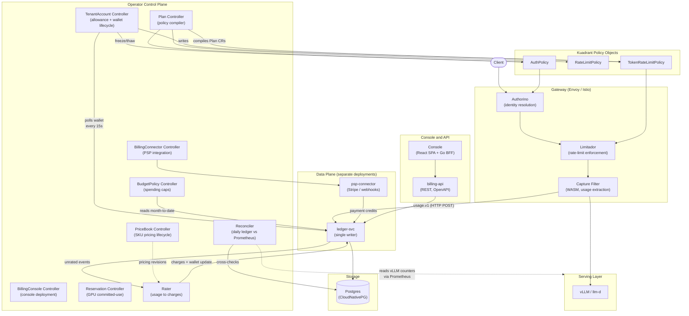

# Architecture Overview

The platform-billing-operator adds metering, rating, prepaid wallets, and payment processing to OpenShift AI's Models-as-a-Service offering. It installs alongside RHOAI and Kuadrant (Connectivity Link), filling the gap between Kuadrant's token rate-limiting and actual commercial operations: per-request billing-grade metering, prepaid balance enforcement, payment processor integration, budget policies, and invoice generation. A product-neutral billing core supports multiple metering profiles (MaaS today, GPUaaS planned) behind a single wallet and invoice per customer.

## Component Diagram

## Data Flow

The lifecycle of a single inference request through the billing pipeline:

1. **Identity resolution.** The client sends a request with an API key. Authorino resolves the key to a tenant ID and tier via DevPortal enforcement secrets. Identity is placed into Envoy filter metadata for downstream filters.

2. **Rate-limit enforcement.** Limitador evaluates the request against TokenRateLimitPolicy and RateLimitPolicy compiled from the tenant's Plan. Frozen tenants are rejected by an AuthPolicy deny rule. Within-limits requests proceed to the serving runtime.

3. **Capture.** On response completion, the capture filter extracts the usage object (input tokens, output tokens, reasoning tokens, cached tokens, status, latency) and emits a `usage.v1` JSON event over HTTP POST to ledger-svc. For streaming responses, the filter parses the final SSE chunk. For client disconnects, it emits a partial-usage event. Events are disk-buffered during ledger outages. Identity is always sourced from Authorino filter metadata.

4. **Idempotent ingest.** ledger-svc upserts the event on `request_id`. Conflicting rows with different content go to the dead-letter queue. Usage events are never overwritten.

5. **Rating.** The rater reads unrated events, resolves the applicable PriceBook revision, and writes a charge row. The wallet balance is updated transactionally with the charge insert. All money is represented as decimal strings in CRDs and `NUMERIC(18,6)` in the database -- never floats.

6. **Allowance feedback.** The allowance controller polls the wallet every 15 seconds per prepaid tenant. It computes a rolling token grant and writes it as a TokenRateLimitPolicy override. Limitador picks this up and adjusts enforcement at the gateway, closing the loop from "money spent" to "limits tightened."

7. **Depletion and state transitions.** When balance hits zero, the tenant enters Grace (reduced allowance for a configurable window). If no payment arrives, the tenant moves to Frozen (AuthPolicy deny applied at the gateway). The freeze is enforcement-layer only and reverses on payment.

8. **Auto-reload.** When balance drops below the reload threshold, the PSP connector creates a PaymentIntent with an idempotency key. On success, the connector verifies the payment against the PSP API, credits the ledger, and the tenant returns to Active.

9. **Reconciliation.** Daily, the reconciler compares ledger token sums against vLLM's Prometheus counters. Drift beyond tolerance produces an alert and a signed report. Gaps are quantified and visible on the console's Metering Health screen.

## Component Descriptions

### Policy Compiler (Plan Controller)

Translates Plan CRs into the Kuadrant policy objects the gateway enforces: TokenRateLimitPolicy, RateLimitPolicy, and AuthPolicy. Uses server-side apply with `fieldManager: platform-billing-operator`. If Kuadrant CRDs are absent, it sets a `KuadrantNotInstalled` condition and requeues rather than crashing.

### Allowance Controller (TenantAccount Controller)

The core enforcement loop. Reads a tenant's wallet balance from the ledger, computes a rolling token grant (`clamp(balance / price_per_token_estimate, 0, plan_tpm)`), and writes it as a tenant-specific TokenRateLimitPolicy override. Manages the Active / Grace / Frozen state machine. Built behind an `EnforcementBackend` interface so GPUaaS can plug in a backend that adjusts Kueue ClusterQueue quotas instead.

### Capture Filter

A lightweight WASM filter in the Envoy filter chain at the gateway. Injects `stream_options.include_usage` on streaming requests and sniffs the response stream for the usage object. Adds no latency to the client streaming experience (parsing happens after the last client byte). Emits `usage.v1` events to ledger-svc over HTTP POST with disk-buffered delivery. If upstream Kuadrant adds native per-request usage emission, the `MeteringPipeline` source swaps and the filter is retired.

### ledger-svc

The single writer to Postgres. Exposes both a gRPC API (for controllers, billing-api, and console BFF) and an HTTP API (convenience endpoint used by the WASM capture filter). All other components access the database through it. Enforces the append-only invariant on charges, adjustments, and invoices via database triggers. The wallet balance is reconstructible from `sum(adjustments) - sum(charges)`.

### Rater

A deterministic pure function: `rate(event, pricebook, tenant) -> charge`. Re-running the rater over the same ledger and PriceBook produces identical output, enforced by a property test in CI. Volume tier rebates are handled as credit adjustment rows, never mutations of past charges.

### PSP Connector

A separate deployment that handles Stripe and generic webhook integration. Outbound: creates PaymentIntents with idempotency keys. Inbound: receives webhooks with mandatory signature verification and corroborates every payment event against the PSP API before crediting the ledger. Isolated from the operator manager so a compromise of the operator process does not expose payment credentials.

### Budget Evaluator (BudgetPolicy Controller)

Evaluates BudgetPolicy caps every minute against month-to-date ledger sums, grouped by labels (project, cost center). Fires threshold actions exactly once per period: Notify (webhook + Kubernetes Event), Throttle (reduced TPM via the policy compiler), Freeze (AuthPolicy deny for matching keys).

### Console and BFF

A React SPA with a Go BFF, deployed via a `BillingConsole` CR. Provider and tenant portals with guided walkthroughs for PSP integration. The BFF is a thin proxy over billing-api -- one implementation of every read/write, with the console as just another API client.

### Reconciler

Daily cross-check of ledger token sums against Prometheus counters (`vllm:prompt_tokens_total`, `vllm:generation_tokens_total`) per model. Also self-checks wallet balance mirrors, compiled-policy drift counts, and DLQ age. Drift beyond tolerance produces a `ReconcileDrift` condition, an alert, and a signed drift report.

## Key Design Principles

1. **Money never authoritative in etcd.** Kubernetes CRs configure billing; the ledger database is the source of truth for balances and charges.
2. **Fail degraded, never free.** If metering fails, enforcement tightens. No error path removes rate limits.
3. **Enforcement observed, not forked.** We write Kuadrant CRs. We never bypass or reimplement Limitador.
4. **Billing core is product-neutral.** The same wallet, invoice, and rating system serves MaaS, GPUaaS, and future products.
5. **Capture before rate.** Raw usage events are immutable. Rating is a pure function replayed from them.
6. **GitOps-clean.** The console writes only CRs and Secrets. Nothing bypasses the Kubernetes control plane.
7. **Operator lifecycle.** OLM-managed with CRD versioning and migration support.

## Integration Points

- **Kuadrant (Connectivity Link):** We write TokenRateLimitPolicy, RateLimitPolicy, and AuthPolicy CRs; we never bypass Limitador or reimplement enforcement.
- **RHOAI / vLLM:** The capture filter observes inference responses; we never modify the serving path.
- **Prometheus (User Workload Monitoring):** All components expose metrics via ServiceMonitors; the reconciler uses vLLM Prometheus counters as independent ground truth.
- **CloudNativePG:** Manages the Postgres cluster backing the billing ledger.
- **Gateway API:** Plan CRs compile to policies that target the gateway via `targetRef`; the capture filter attaches via Istio's WasmPlugin or EnvoyFilter mechanism.
- **DevPortal (Kuadrant):** API key lifecycle managed through DevPortal CRDs (APIProduct, APIKey, APIKeyApproval); TenantAccount watches APIKey CRs for billing association.
